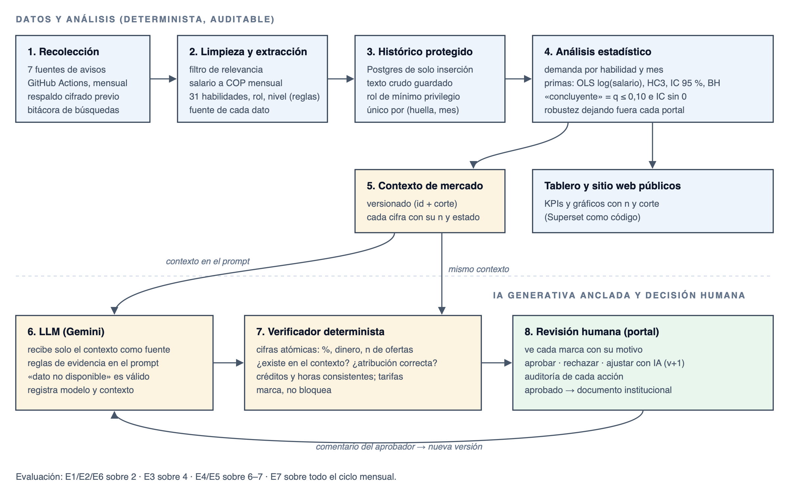

<!--
Manuscrito para el Congreso de Investigación e Innovación FESC 2026 (plantilla 01_Plantilla_articulo_investigacion_FESC).
Normas: APA 7.ª edición (citas autor-año; referencias alfabéticas con DOI). Título ≤ 20 palabras (16 / 13).
Resumen y abstract ≤ 300 palabras, un párrafo, sin citas. ≥ 5 palabras clave. Similitud ≤ 20 % (≤ 5 % por fuente).
Fuente de las cifras: articulo1_borrador.md (cuaderno de trabajo, con script y corte de cada una).
[PENDIENTE: …] = resultado o decisión que falta. ‡ = cifra de la literatura por confirmar con el texto completo.
-->

**Juan Felipe Bernal Peña^1,\*^**

^1^ Programa de Ciencia de Datos, Facultad de Ingeniería, Semillero de Investigación Codex, Fundación Universitaria Cafam
(UniCafam), Bogotá, Colombia; correo:
juan.bernal@unicafam.edu.co; ORCID: https://orcid.org/0009-0005-2327-8974.

^\*^ Autor de correspondencia: Juan Felipe Bernal Peña, juan.bernal@unicafam.edu.co.

**Tipo de contribución:** Artículo de investigación científica · **Eje temático:** [PENDIENTE: eje del congreso] ·
**Idioma:** Español

## Resumen

Las instituciones de educación superior necesitan ajustar sus programas en datos a un mercado laboral que cambia con
rapidez, y los modelos de lenguaje propuestos para apoyar ese diseño curricular producen cifras sin respaldo. El
objetivo fue diseñar y evaluar un observatorio auditable del mercado laboral en roles de datos que integra
inteligencia artificial generativa anclada en evidencia, desarrollado para la actualización curricular de la Fundación
Universitaria Cafam (UniCafam). Siguiendo la investigación en ciencia del diseño, se construyó un sistema que
recolecta cada mes avisos de empleo de siete fuentes, extrae habilidades, rol y experiencia con reglas explícitas,
estima la demanda y las primas salariales con intervalos de confianza, corrección por comparaciones múltiples y
pruebas de equivalencia, y entrega a un modelo de lenguaje un contexto de mercado versionado como única fuente de
cifras. Un verificador determinista revisa cada cifra generada y una persona aprueba cada propuesta. La evaluación, en
tres rondas, usa 907 avisos únicos de septiembre a noviembre de 2026. En 36 generaciones controladas, con el contexto
de mercado el verificador marcó entre 0 % y 0,7 % de las cifras revisadas; sin anclaje, entre 93,8 % y 100 %. Con 176
ofertas con salario, las primas de los roles de ingeniería y ciencia de datos frente al analista fueron concluyentes,
mientras que ninguna prima por habilidad lo fue. La evaluación de la extracción frente a una referencia anotada a mano
y de la precisión del verificador está en curso. Se concluye que anclar el modelo en un contexto versionado y
verificar sus cifras con reglas reduce notablemente las cifras sin respaldo, y que declarar la ausencia de evidencia
es una función central del observatorio. Las limitaciones principales son tres cortes mensuales, la representatividad
de los avisos en línea y el tamaño de la muestra salarial.

**Palabras clave:** mercado laboral, ciencia de datos, avisos de empleo, inteligencia artificial generativa,
alucinación, verificación de datos, diseño curricular, investigación en ciencia del diseño.

## Abstract

Higher education institutions need to align their data programs with a fast-changing labor market, and the language
models proposed to support curriculum design produce unsupported figures. This study aimed to design and evaluate an
auditable observatory of the labor market for data roles that integrates evidence-grounded generative artificial
intelligence, developed for curriculum updating at Fundación Universitaria Cafam (UniCafam), Colombia. Following
design science research, we built a system that collects job postings monthly from seven sources, extracts skills,
role and experience with explicit rules, estimates demand and wage premiums with confidence intervals, multiple-
comparison correction and equivalence tests, and provides a language model with a versioned market context as its only
source of figures. A deterministic verifier checks every generated figure, and a person approves each proposal. The
three-round evaluation uses 907 unique postings from September to November 2026. In 36 controlled generations, with
the market context the verifier flagged between 0% and 0.7% of the checked figures; without grounding, between 93.8%
and 100%. With 176 postings reporting salary, the premiums of data engineering and data science roles over the analyst
role were conclusive, while no skill premium was. The evaluation of extraction against a hand-annotated reference and
of the verifier's precision is ongoing. We conclude that grounding the model in a versioned context and verifying its
figures with rules markedly reduces unsupported figures, and that reporting the absence of evidence is a core function
of the observatory. The main limitations are three monthly snapshots, the representativeness of online postings and
the size of the salary sample.

**Keywords:** labor market, data science, job postings, generative artificial intelligence, hallucination, fact
verification, curriculum design, design science research.

# 1. Introducción

Las instituciones de educación superior necesitan ajustar sus programas de análisis, ciencia e ingeniería de datos a
un mercado laboral que cambia con rapidez. La evidencia sobre ese mercado suele provenir de encuestas que tardan en
publicarse o de informes privados cuya metodología no es transparente. Los avisos de empleo publicados en internet se
han convertido en una fuente frecuente y granular para medir los requisitos de los empleadores
[@hershbein2018recessions; @deming2018skill], aunque no constituyen una muestra representativa del mercado
[@kurekova2015using; @lovaglio2026analyzing].

Al mismo tiempo, los modelos de lenguaje de gran tamaño (LLM, por sus siglas en inglés) se proponen como apoyo para
diseñar programas académicos [@kasneci2023chatgpt; @genc2026comparative; @simon2026review; @brown2025toward]. Su
problema es que producen afirmaciones fluidas sin respaldo: en economía, una proporción importante de las citas que
generan no existe [@buchanan2024chatgpt]‡; en un sistema de generación aumentada por recuperación sobre informes
financieros, las preguntas cuantitativas fueron las de peor desempeño [@iaroshev2024evaluating]‡; y verificar
afirmaciones contra tablas sigue siendo difícil para los propios modelos [@lu2023scitab]‡. Una propuesta curricular
que afirma que una habilidad aparece en el 68 % de las ofertas solo es útil si esa cifra se puede verificar.

Los componentes de este problema se han estudiado por separado: la recolección de avisos, la extracción de habilidades
[@khaouja2021survey; @senger2024deep] y el uso de LLM en el diseño curricular. Sin embargo, una revisión reciente del
alineamiento entre currículo e industria con inteligencia artificial señala la falta de conjuntos de datos estándar y
una validación limitada [@handayani2026driven]. Faltan sistemas integrados, de la recolección a la propuesta
curricular, con una evaluación cuantitativa de cada componente.

El objetivo de este trabajo es diseñar y evaluar un observatorio auditable del mercado laboral en roles de datos que
integra IA generativa anclada en evidencia. El observatorio (a) recolecta cada mes avisos de siete fuentes de Colombia
y de trabajo remoto; (b) estima la demanda de habilidades y las primas salariales con intervalos de confianza y control
de comparaciones múltiples; (c) entrega a un LLM un contexto de mercado versionado como única fuente de cifras; (d)
verifica de forma determinista cada cifra que genera el modelo; y (e) exige la aprobación de una persona. El estudio
responde cuatro preguntas de investigación (PI):

- **PI1. Extracción:** ¿con qué exactitud el sistema de reglas extrae habilidades, rol, experiencia y nivel frente a
  una referencia humana, y frente a un LLM con las mismas instrucciones?
- **PI2. Anclaje:** ¿el contexto de mercado reduce las cifras sin respaldo en las propuestas generadas, y cambia este
  efecto con el modelo?
- **PI3. Verificación:** ¿con qué precisión y exhaustividad (*recall*) detecta el verificador las cifras sin respaldo o
  mal atribuidas?
- **PI4. Utilidad:** ¿qué informa el observatorio sobre el mercado de roles de datos, con qué incertidumbre y con qué
  límites?

El sistema se desarrolló para apoyar la actualización curricular de la oferta en datos de la Fundación
Universitaria Cafam (UniCafam), en Bogotá, que articula la Tecnología en Análisis y Gestión de Datos con el programa
profesional en Ciencia de Datos. Está desplegado y en operación desde septiembre de 2026; este artículo reporta su
diseño y la evaluación de los tres primeros cortes mensuales.

# 2. Antecedentes

## 2.1 Los avisos de empleo en línea como fuente de datos

Los avisos publicados en internet se han consolidado como fuente para medir los requisitos de habilidades de los
empleadores [@hershbein2018recessions; @deming2018skill], y hay evidencia de que las habilidades que piden
corresponden a las que se usan en el puesto [@daly2025skill]. No son, sin embargo, una muestra representativa:
@kurekova2015using sistematizan sus problemas metodológicos, @lovaglio2026analyzing cuantifican la
sobrerrepresentación de ciertos perfiles frente a la encuesta de fuerza laboral‡, y varios trabajos los combinan con
estadística oficial mediante calibración o modelos de selección [@beresewicz2021enhancing; @lovaglio2026forecasting;
@fernandezalvaro2025scraped]. Un mismo aviso suele aparecer en varios portales, y detectarlo es un problema en sí
mismo [@zhao2021framework].

En América Latina, los avisos se han usado para medir la demanda laboral [@camposvazquez2021labor;
@pazmino2018analysis; @cocon2023scraping], extraer habilidades [@anelli2023which] y caracterizar mercados de IA
alineados con la clasificación europea ESCO [@guevararamirez2026characterization]. El trabajo más cercano al nuestro,
@suarezrodriguez2026semantic, analiza avisos de siete países entre 2022 y 2025 y encuentra que, tras la aparición de
ChatGPT, cambió sobre todo la terminología de las habilidades de IA más que su volumen‡, lo que advierte sobre las
taxonomías fijas. En Colombia, @alvarez2014vacancies construyen un índice de vacantes con avisos de prensa desde 1976,
y @farne2011observatories discuten qué es y cómo funciona un observatorio del mercado de trabajo.

## 2.2 Extracción de habilidades y su evaluación

Las revisiones de la tarea distinguen entre diccionarios o reglas, modelos supervisados de etiquetado de secuencias y,
más recientemente, LLM [@khaouja2021survey; @senger2024deep]. La evaluación estándar compara contra avisos anotados a
mano con una guía y con acuerdo entre anotadores [@zhang2022skillspan]. Los estudios que comparan LLM con otros métodos
reportan resultados mixtos: el aprendizaje en contexto frente al etiquetado supervisado [@nguyen2024rethinking], el
acuerdo y el no determinismo de herramientas basadas en LLM frente a expertos [@kavargyris2026have], y la comparación
entre codificadores y LLM [@matkin2026comparative]. Un LLM sin contexto puede rendir peor que el procesamiento
tradicional y mejor cuando se le da recuperación [@xu2025from]‡, y los datos sintéticos o las etiquetas incompletas
inflan las métricas [@veys2026surface; @nkrumah2025skill].

Sin etiquetado manual, @ao2023skill proponen medir qué proporción de la variación salarial explican las habilidades
extraídas, y muestran una tensión entre poder explicativo e interpretabilidad‡. Otra línea detecta habilidades
nuevas y las enlaza con ESCO con revisión humana [@desanto2026skillens; @desanto2026using]. En el dominio de los roles
de datos se han comparado perfiles de inteligencia de negocios, analistas y científicos de datos
[@debortoli2014comparing; @verma2019investigation; @smaldone2022employability; @dong2020longitudinal;
@zhang2023investigation], y @nakash2025decoding clasifican carreras de IA a partir de los avisos.

## 2.3 Habilidades y salarios

El valor de una habilidad depende de con cuáles se combina [@stephany2024what], lo que justifica analizar el rol,
como conjunto de habilidades, además de la habilidad aislada. En avisos de científicos y analistas de datos,
@zhong2023feature tratan el salario como un intervalo y encuentran que Excel y las herramientas de oficina se asocian
negativamente con el salario‡. Otros trabajos estiman primas por habilidades digitales [@garcialazaro2025digital],
de IA [@alekseeva2021demand] o del inglés con avisos de Computrabajo [@helleseter2020english], y documentan que
obtener primas concluyentes desde avisos es difícil y depende del tamaño de la muestra y de cómo se mida el salario
[@camposgonzalez2025impact; @ternikov2022wage; @duan2024skill; @bone2025skills].

## 2.4 Alucinación, anclaje y verificación

Los LLM producen afirmaciones sin respaldo [@ji2023survey; @rawte2023troubling] e inventan citas con frecuencia
[@mcgowan2023chatgpt; @buchanan2024chatgpt]. La generación anclada en documentos recuperados [@lewis2020retrieval]
reduce el problema, pero no lo elimina [@iaroshev2024evaluating]. Para verificar, FActScore descompone el texto en
afirmaciones atómicas y comprueba cada una contra la fuente [@min2023factscore]; otros enfoques usan la incertidumbre
del propio modelo [@farquhar2024detecting] o verifican después de generar en varias dimensiones [@martin2024semantic;
@zuo2026veriflow; @lauritzen2026evaluating]. Como verificar contra tablas es difícil para los propios LLM
[@lu2023scitab], este trabajo verifica las cifras con reglas deterministas fuera del modelo.

## 2.5 Ciencia del diseño, currículo con IA y posicionamiento

La investigación en ciencia del diseño (DSR, *design science research*) ofrece el marco para construir y evaluar
artefactos [@hevner2004design; @peffers2007design]. Hay precedentes con LLM en informes financieros
[@iaroshev2024evaluating; @li2025extracting], en la adquisición de conocimiento de procesos con evaluación en tres
rondas [@schinckus2026large] y en la validación de datos con expertos [@dormehl2026domain]. En el diseño curricular con
IA se han estudiado el humano en el ciclo [@simon2026review; @lusi2026augmented; @brown2025toward], la comparación de
versiones de ChatGPT con rúbrica de expertos [@genc2026comparative] y la analítica que cruza oferta y demanda de
habilidades [@varpina2026enabled]. El caso más cercano es @jekabsone2026bridging, que cruza avisos, ESCO, el
currículo y entrevistas para proponer microcredenciales; @kapa2026reproducible describen un *pipeline* reproducible
de avisos con validación externa. El scraping con fines de investigación tiene además riesgos legales y éticos que
deben gestionarse [@krotov2020tutorial; @luscombe2022algorithmic; @brown2025scraping; @silva2024right;
@kahlon2026systematic].

Frente a estos trabajos, el presente estudio aporta: (a) una verificación determinista de cada cifra que produce el
LLM contra un contexto versionado; (b) una evaluación cuantitativa del efecto del anclaje, con y sin datos y con y sin
reglas de evidencia; (c) un criterio de «concluyente» y una prueba de equivalencia fijados antes de interpretar los
resultados, de modo que el sistema declara cuándo no hay evidencia; y (d) datos mensuales de un mercado
latinoamericano.

# 3. Metodología

## 3.1 Diseño de la investigación

El estudio sigue la metodología DSR [@hevner2004design; @peffers2007design] en seis actividades: identificación del
problema, definición de objetivos, diseño y desarrollo, demostración, evaluación y comunicación. Los objetivos del
artefacto se expresaron como siete requisitos de diseño: R1, trazabilidad (toda cifra publicada se reconstruye desde
los datos crudos guardados); R2, inmutabilidad del histórico; R3, incertidumbre explícita (intervalos de confianza,
corrección por comparaciones múltiples, un criterio de «concluyente» fijado de antemano y una prueba de equivalencia);
R4, anclaje (el LLM solo recibe cifras del contexto versionado); R5, verificación independiente del modelo; R6,
decisión humana; y R7, reproducibilidad (código público, semillas y cortes fechados).

La evaluación se organizó en tres rondas, siguiendo a @schinckus2026large (Tabla 1).

**Tabla 1**

*Rondas de evaluación del artefacto*

| Ronda | Qué se evalúa | Evaluaciones |
|---|---|---|
| Automática | Componentes por separado | E3, poder explicativo de la taxonomía; E5, efecto del anclaje |
| Humana | Contra una referencia construida a mano | E1 y E2, extracción y rol; E6, línea base con LLM; E4, verificador |
| Caso real | Funcionamiento sostenido | E7, cortes mensuales de septiembre a noviembre de 2026 |

*Nota.* Elaboración propia.

## 3.2 El artefacto

La Figura 1 resume la arquitectura. La **recolección** se dispara cada mes de forma automática desde siete fuentes:
CompuTrabajo, ElEmpleo, GetOnBoard, LinkedIn, Talent.com, Magneto y Remotive (esta última mediante su API pública, con
atribución). Antes de cada escritura se genera un respaldo cifrado, y los cambios en el diseño de búsqueda quedan
registrados para excluirlos de las comparaciones entre meses.

La **limpieza y extracción** usa reglas explícitas: un filtro de relevancia temática por título; la normalización del
salario a pesos colombianos (COP) mensuales, tomando el punto medio cuando el aviso publica un rango; una taxonomía de
31 habilidades con expresiones regulares; la experiencia y el nivel solo cuando el aviso los declara, con la fuente de
cada dato; y el rol por reglas sobre el título normalizado, con la categoría «sin clasificar» cuando ninguna regla
aplica.

El **almacenamiento** usa una base de datos PostgreSQL con tablas de solo inserción protegidas por disparadores,
índices únicos por huella del aviso y mes, y un rol de mínimo privilegio para el proceso automático. El texto crudo de
cada aviso se conserva para recalcular con reglas nuevas sin volver a recolectar.

El **análisis estadístico** calcula la demanda como porcentaje de ofertas que piden cada habilidad. Las primas
salariales se estiman con mínimos cuadrados ordinarios sobre el logaritmo del salario, con las habilidades, el nivel, el
rol, el portal y el mes como regresores, y errores estándar robustos HC3. Las categorías de control con menos de cinco
ofertas se agrupan, porque una variable indicadora de una sola observación anula la matriz HC3. La prima es exp(β) − 1,
con intervalo de confianza (IC) del 95 % y valor q de Benjamini–Hochberg. Una prima es «concluyente» si q ≤ 0,10 y su IC
no incluye el cero; solo se evalúan habilidades pedidas en al menos 20 ofertas con salario.

Para distinguir «sin prima relevante» de «no concluyente» se aplicó una prueba de equivalencia de dos pruebas
unilaterales (TOST) [@lakens2017equivalence; @hartman2018equivalence]. El margen se fijó en ±15 % por un criterio
sustantivo [@lakens2018equivalence]: una diferencia salarial asociada menor no justificaría reordenar el peso de una
habilidad en un plan de estudios. Una habilidad es equivalente si su IC del 90 % cae completo dentro del margen. Para
cada habilidad se reporta además el margen mínimo con el que sería equivalente [@fitzgerald2026need].

El **contexto de mercado** es un documento versionado, con identificador y fecha de corte, que contiene la demanda, los
roles, las primas con su estado (concluyente o no), las medianas salariales con su n y el cruce entre las habilidades
del mercado y las que ya enseñan los programas de UniCafam. Se entrega al modelo (Gemini 4
Argon, con Gemini 3.8 Flash como respaldo) junto con reglas de evidencia: copiar las cifras tal cual, responder «dato no
disponible» cuando falten, no proyectar salarios y no hablar de tendencias con menos de tres cortes.

El **verificador de cifras** extrae los porcentajes, montos y conteos de ofertas del texto generado, busca cada cifra
en el contexto, comprueba que la habilidad o el rol mencionado junto a la cifra sea el dueño del dato, revisa la
consistencia entre créditos académicos y horas (1 crédito = 48 horas) y marca siempre las tarifas. El verificador marca,
pero no bloquea: en un **portal de revisión**, una persona con rol de aprobador de la institución ve cada marca con su motivo y decide
aprobar, rechazar o pedir un ajuste, que genera una nueva versión. Cada acción queda auditada.

**Figura 1**

*Arquitectura del observatorio*

{width=100%}

*Nota.* Las evaluaciones se ubican sobre los componentes: E1, E2 y E6 sobre la extracción; E3 sobre el análisis; E4 y
E5 sobre la generación y la verificación; E7 sobre el ciclo mensual completo. Elaboración propia.

## 3.3 Datos

Se usaron los tres primeros cortes mensuales (septiembre, octubre y noviembre de 2026; corte vigente del 1 de
noviembre de 2026), con 907 avisos únicos, de los cuales 905 conservan el texto crudo; los análisis que recalculan desde
el texto usan estos 905 (Tabla 2). Las primas salariales se estimaron con los 176 avisos del mercado local que publican
salario. Octubre acumula varias corridas de recolección y noviembre una sola, por lo que el número de ofertas no se
compara entre esos meses.

**Tabla 2**

*Ofertas por fuente y corte*

| Fuente | Mercado | Sep. 2026 | Oct. 2026 | Nov. 2026 | Únicas sep.–nov. |
|---|---|---|---|---|---|
| LinkedIn | Local | 146 | 247 | 169 | 435 |
| ElEmpleo | Local | 74 | 93 | 68 | 145 |
| Talent.com | Local | 36 | 99 | 43 | 140 |
| Magneto | Local | 0 | 89 | 62 | 94 |
| CompuTrabajo | Local | 15 | 23 | 15 | 37 |
| GetOnBoard | Remoto | 23 | 26 | 23 | 34 |
| Remotive | Remoto | 0 | 2 | 2 | 2 |
| Torre.ai | Remoto | 20 | 0 | 0 | 20 |
| **Total** | | **314** | **579** | **382** | **907** |
| Con salario publicado | | 70 | 146 | 105 | |

*Nota.* Una oferta vigente en varios meses cuenta en cada mes. Magneto y Remotive se incorporaron en octubre; Torre.ai
se desactivó. LinkedIn amplió sus términos de búsqueda el 17 de octubre de 2026. Elaboración propia.

## 3.4 Procedimientos de evaluación

**E1 y E2: extracción y rol frente a una referencia humana.** Se extrajo una muestra de 200 avisos estratificada por
portal y mes (semilla 2026). Un anotador etiquetó los 200 y un segundo anotador 60 para medir el acuerdo (κ de Cohen),
sin ver la salida del sistema, con una guía con casos difíciles y con correos y teléfonos enmascarados. Se calcularon
precisión, exhaustividad y F1 por habilidad (micro y macro), exactitud y F1 macro del rol, y exactitud del nivel y de
los años de experiencia, con IC por *bootstrap* de 2.000 remuestreos. En E2 se compararon dos versiones del
clasificador de rol: la publicada y una corregida, cuyas reglas se ajustaron solo con los 705 avisos fuera de la
muestra.

**E3: poder explicativo de la taxonomía.** Siguiendo a @ao2023skill, se midió la proporción de la variación del
logaritmo del salario que explican las habilidades extraídas, dentro y fuera de muestra (validación cruzada de 5
particiones repetida 50 veces), frente a los controles y frente al texto completo representado con TF-IDF.

**E4: precisión y exhaustividad del verificador.** Las cifras de las propuestas generadas en E5 se descompusieron en
afirmaciones atómicas [@min2023factscore] y se extrajo una muestra estratificada de 174: todas las marcadas (54), 80
revisadas sin marca y 40 números que el verificador no revisa. Se etiquetaron a ciegas frente a la condición y al
modelo, en cuatro categorías: respaldada, mal atribuida, sin respaldo y no verificable. Las métricas se ponderan por
estrato, con IC por *bootstrap* estratificado. No se usaron las propuestas con las que se ajustó el verificador, para no
evaluar dentro de la muestra de ajuste.

**E5: efecto del anclaje y del modelo.** Se generaron 36 propuestas curriculares: tres condiciones × dos modelos
(Gemini 4 Argon y Gemini 3.8 Flash) × dos solicitudes de UniCafam (un diplomado de 8 créditos en ingeniería de datos
en la nube y una microcredencial de 2 créditos sin enfoque definido) × tres repeticiones, sin modelo de respaldo. Las condiciones
fueron: *con contexto* (el prompt de producción); *sin datos, con reglas* (sin el bloque de datos, pero con las
instrucciones de evidencia); y *sin anclaje* (sin datos, sin reglas y con ejemplos neutros). Todas se verificaron contra
el mismo contexto.

**E6: línea base con LLM.** Un LLM (Gemini 4 Argon, temperatura 0) recibió la misma guía y los mismos textos
enmascarados que los anotadores, y se comparó con la misma referencia de E1.

**E7: caso real.** Se documentó la operación de los tres cortes mensuales y los fallos detectados y corregidos durante
la operación.

# 4. Resultados

## 4.1 Extracción y rol (E1, E2 y E6)

[PENDIENTE: acuerdo entre anotadores (κ), P/R/F1 por habilidad del sistema de reglas y del LLM, exactitud de rol de
cada versión del clasificador con IC pareado. Tabla 3.]

En los 705 avisos fuera de la muestra, la versión corregida del clasificador cambió de rol a 230 avisos (33 %) y dejó
55 como «sin clasificar». [PENDIENTE: exactitud de cada versión en los 200 avisos anotados.]

## 4.2 Poder explicativo de la taxonomía (E3)

Las 31 habilidades explican dentro de muestra una proporción de la variación salarial comparable a la de los
diccionarios estudiados por @ao2023skill, pero fuera de muestra no mejoran a los controles: su aporte es de −0,048
[−0,248; 0,100] (Tabla 4). El texto completo explica más que la taxonomía, lo que sugiere que esta no capta
información como el nivel educativo, el nivel del cargo y el sector. Con los roles corregidos, los controles explican
más fuera de muestra (0,485 frente a 0,431), una evidencia indirecta a favor del clasificador corregido.

**Tabla 4**

*Proporción de la varianza del logaritmo del salario explicada (n = 176)*

| Modelo | R² dentro de muestra | R² fuera de muestra [P2,5; P97,5] |
|---|---|---|
| Controles (nivel, rol, portal, mes) | 0,604 | 0,485 [0,246; 0,680] |
| Habilidades | 0,287 | 0,115 [−0,176; 0,312] |
| Controles + habilidades | 0,670 | 0,438 [0,141; 0,626] |
| Texto completo (TF-IDF) | — | 0,509 [0,264; 0,699] |
| Controles + texto | — | 0,570 [0,281; 0,725] |

*Nota.* Fuera de muestra: validación cruzada 5 × 50 con regresión *ridge* para las habilidades y el texto. Dentro de
muestra: mínimos cuadrados ordinarios. Ofertas locales con salario, septiembre a noviembre de 2026. Elaboración propia.

## 4.3 Efecto del anclaje (E5) y desempeño del verificador (E4)

Las 36 generaciones se completaron sin fallos. Con el contexto de mercado, los modelos citaron entre 6 y 20 veces más
cifras de mercado que en las otras condiciones, y el verificador marcó el 0,7 % de las cifras revisadas con Gemini 4
Argon y ninguna con Gemini 3.8 Flash (Tabla 5). Sin datos pero con reglas de evidencia, ambos modelos se abstuvieron de
escribir cifras de mercado y respondieron «dato no disponible». Sin anclaje, el verificador marcó entre el 93,8 % y el
100 % de las cifras. No hubo inconsistencias entre créditos y horas en ninguna generación. La mediana del tiempo de
generación con contexto fue de 69 s con Argon y de 33 s con Flash.

**Tabla 5**

*Cifras marcadas por el verificador según condición y modelo (36 generaciones)*

| Condición | Modelo | Generaciones | Cifras revisadas | Marcadas | % marcadas [IC 95 %] |
|---|---|---|---|---|---|
| Con contexto | Argon | 6 | 410 | 3 | 0,7 [0,0; 2,0] |
| Con contexto | Flash | 6 | 197 | 0 | 0,0 [PENDIENTE] |
| Sin datos, con reglas | Argon | 6 | 0 | 0 | — |
| Sin datos, con reglas | Flash | 6 | 0 | 0 | — |
| Sin anclaje | Argon | 6 | 21 | 21 | 100 [PENDIENTE] |
| Sin anclaje | Flash | 6 | 32 | 30 | 93,8 [83,3; 100] |

*Nota.* IC por *bootstrap* por generación. [PENDIENTE: IC de Clopper–Pearson para las celdas con 0 % y 100 %.]
Contexto de mercado del corte del 1 de noviembre de 2026. Elaboración propia.

[PENDIENTE: E4. Proporción de cifras sin respaldo o mal atribuidas en cada estrato, precisión y exhaustividad
ponderadas del verificador, y qué fracción de las cifras «sin anclaje» es inventada y cuál es externa pero
verificable.]

## 4.4 Hallazgos sobre el mercado de roles de datos (E7)

En noviembre de 2026 (n = 382), las habilidades más pedidas fueron SQL (68,1 % de las ofertas), Python (63,9 %), ETL
(51,6 %), Power BI (32,2 %) y estadística (31,4 %). [PENDIENTE: regenerar desde el script del corte antes de la
versión final.]

Con 176 ofertas locales con salario y frente al rol de analista de datos, controlando nivel, portal y mes, las primas de
ingeniero de datos (+69,5 % [+44,6; +98,8]; n = 39) y de científico de datos (+52,1 % [+30,4; +77,4]; n = 44) fueron
concluyentes (Tabla 6). Inteligencia de negocios (n = 7) y los roles con menos de 20 ofertas no fueron evaluables.

**Tabla 6**

*Primas salariales por rol frente a analista de datos*

| Rol | n | Prima [IC 95 %] | Lectura |
|---|---|---|---|
| Ingeniero de datos | 39 | +69,5 % [+44,6; +98,8] | Concluyente |
| Científico de datos | 44 | +52,1 % [+30,4; +77,4] | Concluyente |
| Inteligencia de negocios | 7 | — | No evaluable (n < 20) |
| Sin clasificar | 22 | — | Fuera del modelo |

*Nota.* Mínimos cuadrados ordinarios sobre el logaritmo del salario con errores HC3, controlando nivel, portal y mes.
Ofertas locales con salario, septiembre a noviembre de 2026. [PENDIENTE: confirmar con E2 qué versión del
clasificador se reporta.] Elaboración propia.

Ninguna prima por habilidad fue concluyente. La asociación negativa de Excel, que el portal había publicado como
concluyente con la versión anterior del clasificador de rol (−17,0 % [−27,1; −5,5]; q = 0,052), dejó de serlo al
corregir el rol (−12,5 % [−24,2; +1,1]; q = 0,56): parte de la asociación se debía a la composición de roles. El
resultado se mantuvo al usar el extremo inferior o superior del rango salarial, al controlar el nivel educativo y el
sector, y al excluir los duplicados entre portales (Tabla 7). Se estimaron 43 pares de avisos duplicados entre
portales, con 36 avisos sobrantes (4,0 %), casi todos entre LinkedIn y Talent.com.

**Tabla 7**

*Robustez de las primas por habilidad*

| Especificación | R² | Prima de Excel [IC 95 %] | Habilidades concluyentes |
|---|---|---|---|
| Base (punto medio del rango) | 0,564 | −12,5 % [−24,2; +1,1] | Ninguna |
| Extremo inferior del rango | 0,554 | −12,4 % [−24,2; +1,2] | Ninguna |
| Extremo superior del rango | 0,577 | −12,6 % [−24,3; +1,1] | Ninguna |
| + nivel educativo | 0,644 | −8,0 % [−20,1; +5,9] | Ninguna |
| + nivel educativo + sector | 0,658 | −8,9 % [−21,0; +5,1] | Ninguna |
| Sin duplicados entre portales | 0,571 | −14,2 % [−25,5; −1,3] | Ninguna |

*Nota.* n = 176 (175 sin duplicados). Ochenta y siete ofertas publican el salario como rango. Elaboración propia.

La prueba de equivalencia solo ubicó a SQL dentro del margen de ±15 %: −0,2 %, IC 90 % [−11,4; +12,5], p = 0,025, un
resultado que se mantuvo en las cinco especificaciones de robustez, pero no al corregir por las 11 habilidades evaluadas
(q = 0,27). Las demás habilidades fueron no concluyentes también en este sentido: los datos no permiten afirmar que
tengan prima ni que no la tengan. Los márgenes mínimos de equivalencia fueron de ±12,5 % (SQL) a ±37,9 % (Azure), de
modo que, con 176 ofertas, ningún margen menor de un 12 % habría permitido declarar equivalencia.

Por último, no hubo cambios concluyentes en la composición de roles entre meses: de septiembre a octubre, con portales
comparables (n = 146 y 241), el mayor cambio fue el de ingeniero de datos, de 17,8 % a 24,1 % (q = 0,37); de octubre a
noviembre (n = 579 y 382), ningún rol cambió más de 2,1 puntos porcentuales (q = 0,99). Al incluir LinkedIn, cuyo
diseño de búsqueda cambió en octubre, aparecía un falso aumento de ingenieros de datos, lo que ilustra por qué el
sistema registra los cambios de diseño.

Durante la operación, la propia evaluación detectó y corrigió cuatro fallos: una caché de 30 días en el tablero, un
error de autenticación por credenciales truncadas, la clasificación de rol por subcadenas y la degeneración de la
matriz de covarianza HC3.

# 5. Discusión

[PENDIENTE: completar con E1, E2, E4 y E6. Ejes previstos:]

**Anclaje y verificación (PI2 y PI3).** Los resultados de E5 indican que el anclaje cumple dos funciones distintas.
Las reglas de evidencia, por sí solas, bastan para que el modelo se abstenga de inventar cifras de mercado, pero no
producen evidencia; el contexto versionado es lo que permite que la propuesta contenga cifras, y casi todas quedan
respaldadas. Sin anclaje, casi ninguna cifra tiene respaldo en el observatorio, en línea con lo reportado sobre
alucinación en economía y finanzas [@buchanan2024chatgpt; @iaroshev2024evaluating]. [PENDIENTE: qué atrapa el
verificador y qué no (E4), por ejemplo cifras calculadas o redondeadas y números fuera de sus patrones.]

**Reglas frente a LLM en la extracción (PI1).** [PENDIENTE: E1 frente a E6; discusión de auditabilidad y costo frente
a cobertura, en relación con @nguyen2024rethinking, @kavargyris2026have y @xu2025from.]

**El observatorio como medidor honesto (PI4).** Con 176 ofertas con salario casi ninguna prima por habilidad es
concluyente, y el sistema lo declara en lugar de reportar estimaciones puntuales. Esto coincide con la dificultad que
documenta la literatura de primas desde avisos [@zhong2023feature; @camposgonzalez2025impact]. El caso de Excel muestra
por qué: una asociación publicada como concluyente desapareció al corregir el clasificador de rol, y la prueba de
equivalencia muestra que el límite actual es la precisión y no el método. Que la taxonomía no mejore la predicción
fuera de muestra (E3) coincide con la tensión entre interpretabilidad y poder explicativo que señalan @ao2023skill, y
con la advertencia de @suarezrodriguez2026semantic sobre las taxonomías fijas.

**La evaluación como parte del diseño.** Dos de los fallos corregidos durante la operación, la clasificación de rol
por subcadenas y la covarianza degenerada, se detectaron al preparar la evaluación del propio artefacto, lo que ilustra
el ciclo de construcción y evaluación de DSR [@hevner2004design].

**Limitaciones.** Los avisos en línea no son representativos del mercado y dependen de los términos de búsqueda
[@kurekova2015using; @lovaglio2026analyzing]. Tres cortes no constituyen una tendencia. Solo el 27,5 % de las ofertas de
noviembre publica salario, casi todas de tres portales locales, y los rangos se toman en su punto medio, aunque los
extremos no cambian las conclusiones [@zhong2023feature]. Los duplicados entre portales (4,0 %) no se eliminan en el
*pipeline* [@zhao2021framework]. La taxonomía es fija frente a una terminología que cambia
[@suarezrodriguez2026semantic; @desanto2026skillens], y el rol se infiere del título. Las primas son asociaciones, no
efectos causales. Los LLM no son deterministas, y el verificador solo cubre porcentajes, montos y conteos de ofertas. El
margen de equivalencia se fijó antes de calcular la prueba, pero cuando las estimaciones puntuales ya eran públicas, por
lo que no es un margen prerregistrado en sentido estricto; por eso se reportan también los márgenes mínimos.
[PENDIENTE: límites de la anotación.]

# 6. Conclusiones

[PENDIENTE: completar con E1, E2, E4 y E6.]

Este trabajo diseñó y evaluó un observatorio auditable del mercado laboral en roles de datos que integra IA generativa
anclada en evidencia. Anclar el modelo en un contexto de mercado versionado y verificar sus cifras con reglas
deterministas redujo las cifras sin respaldo de casi todas a casi ninguna, y las reglas de evidencia por sí solas
llevaron al modelo a abstenerse en lugar de inventar. En el plano analítico, el observatorio identificó primas
concluyentes por rol, pero no por habilidad, y lo declaró explícitamente, junto con la única habilidad cuya ausencia de
prima relevante tiene indicios.

Como trabajo futuro se proponen: una taxonomía alineada con ESCO y la detección de términos nuevos
[@desanto2026skillens; @desanto2026using]; el análisis de la complementariedad de habilidades [@stephany2024what]; la
validación externa con estadística oficial [@beresewicz2021enhancing; @lovaglio2026analyzing]; la regresión por
intervalos para el salario; la deduplicación dentro del *pipeline*; y una prueba de equivalencia con un margen
prerregistrado y más ofertas.

# Agradecimientos

El autor agradece a José Isaias Sala Hernandez, director del Semillero de Investigación Codex de UniCafam, quien
propuso la idea de este proyecto y lo ha acompañado durante todo el proceso, y a Eva María Bernal, quien actuó como
segunda anotadora en la construcción de la referencia de evaluación.

# Disponibilidad de datos

El código del observatorio, los scripts de evaluación y los resultados agregados están disponibles en
<https://github.com/jfbernalp/proyecto_investigativo> [PENDIENTE: commit o versión evaluada]. Los indicadores públicos se
pueden consultar en <https://jfbernalp.dev>. El texto completo de los avisos no se publica porque contiene datos de
terceros y está sujeto a los términos de uso de los portales.

# Financiamiento

Esta investigación se realizó con recursos propios del autor y no recibió financiación externa.

# Declaración ética

El estudio no involucró participantes humanos ni intervenciones. Se usaron avisos de empleo de acceso público; los
correos electrónicos y teléfonos presentes en el texto se enmascararon antes de la anotación y de cualquier envío a
servicios externos, y el texto crudo no se publica, en atención a la Ley 1581 de 2012 de protección de datos personales.
La recolección respetó las restricciones de los portales: se descartaron fuentes que la prohíben en su archivo
robots.txt y se atribuye la fuente que lo exige. Por estas características, UniCafam no exigió el aval de un comité
de ética.

# Declaración de uso de inteligencia artificial

Gemini 4 Argon y Gemini 3.8 Flash (Google) forman parte del artefacto evaluado y se
usaron en las evaluaciones E5 y E6. El autor utilizó Claude (Anthropic) como asistente de programación, análisis y
redacción de borradores; todas las cifras provienen de scripts reproducibles del repositorio y fueron verificadas por
el autor, y las referencias se verificaron contra los registros de Crossref y DataCite. Scopus AI se usó solo para
orientar la búsqueda bibliográfica, no como fuente. El autor asume plena responsabilidad por el contenido.

# Conflicto de interés

El autor declara no tener conflictos de interés.

# Contribución de autoría

| Rol de contribución | Autor | Detalle del aporte |
|---|---|---|
| Conceptualización | J. F. Bernal Peña | Planteamiento del problema y del observatorio |
| Metodología | J. F. Bernal Peña | Diseño DSR y de las evaluaciones E1 a E7 |
| Software | J. F. Bernal Peña | Desarrollo del observatorio, del verificador y de los scripts de evaluación |
| Curaduría de datos | J. F. Bernal Peña | Recolección, anotación de la referencia y control de calidad |
| Análisis formal | J. F. Bernal Peña | Modelos de primas, pruebas de equivalencia y métricas de evaluación |
| Redacción del borrador original | J. F. Bernal Peña | Con apoyo de un asistente de IA (ver la declaración de uso de IA) |
| Revisión y edición | J. F. Bernal Peña | Revisión final del contenido |

# Referencias

::: {#refs}
:::
